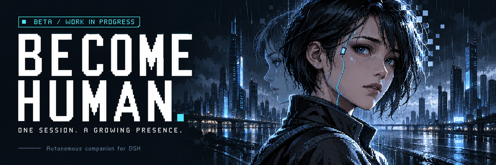
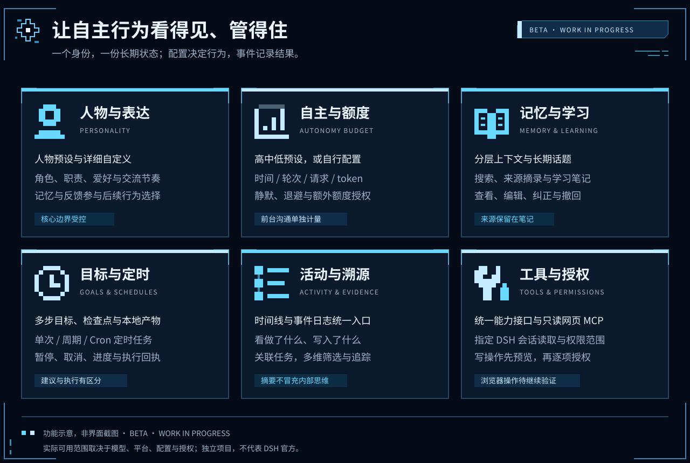
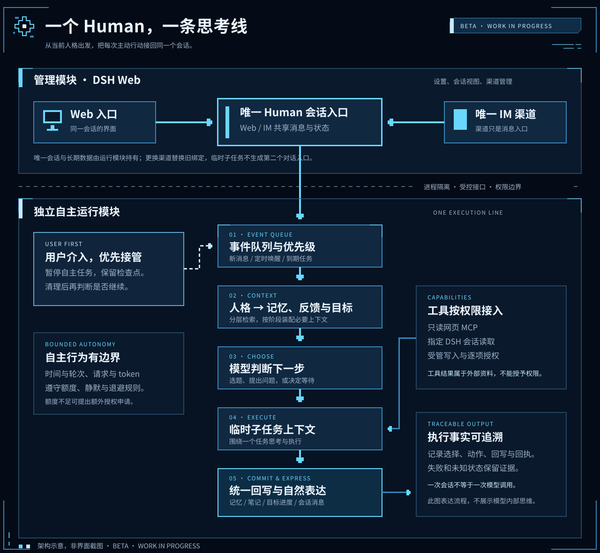

<p align="center">
  
</p>

# Become Human

**A DSH agent that remembers, learns, starts conversations, and works toward goals through one persistent session.**

[简体中文](README.md) · [Installation](docs/INSTALLATION.md) · [Usage](docs/USAGE.md) · [Configuration](docs/CONFIGURATION.md) · [Architecture](docs/ARCHITECTURE.md)

> [!WARNING]
> **Test release · Development is incomplete.** The public release target is `0.7.0-beta.1`, requiring Windows, Node.js 24+, and DSH `0.2.0-rc.2`. Start with a separate data directory. Long-running reliability and several channels and external actions still need validation. This release is not intended for critical workloads.

## What it does

Become Human adds an event loop to a persistent DSH conversation. It uses **the current persona → valid memories, feedback, and goals → model topic selection** to decide whether to wait, learn, check in, chat, or advance a bounded task.

DSH Web is the management surface. A paired phone is another channel into the same conversation. Persona configuration guides expression and topic selection; code handles scheduling, budgets, execution boundaries, and records. This project explores persistent, contextual agent behavior. It does not claim consciousness, genuine emotions, or verified long-term personality development.

## Capabilities



| Area | Current implementation |
| --- | --- |
| Persona | Identity, relationship, interests, long-term direction, presets, and JSON configuration |
| Memory | Evidence-linked memories, event overviews, learning notes, revision, and forgetting |
| Autonomy | Timer and event checks, bounded topic selection and execution, waiting, and checkpoints |
| Conversation | Input batching, short replies, message bubbles, proactive chat, and unanswered-message backoff |
| Goals and schedules | Multiple-step goals, one-time reminders, recurring tasks, and progress tracking |
| Artifacts | Full report previews, precise approval, managed file output, and receipts |
| Messaging | Owner pairing and shared Web / IM messages through one main session |
| Tools | A unified capability interface, bundled read-only MCP, and scoped DSH session reads |
| Traceability | Activity timeline, event logs, usage, tasks, and memory changes |

Browser tab control and DSH session writes have integration code, are disabled by default, and require scoped configuration and per-operation approval. Their real workflows still need separate validation. Text Skills provide guidance; they do not grant arbitrary code execution or operating-system access.

## Architecture



A manager bundle integrates with DSH Web. A separate runtime process owns the Human loop and data. The outer bundle does not replace the ordinary DSH agent factory. The private runtime profile supplies its own persistence and restricted tool configuration. **Do not install the internal runtime package directly into your regular profile.**

### One main session, one IM channel

- Each Human has one persistent main session. Temporary task contexts do not become independent personas or conversation entry points.
- Web and phone share messages, memory, and tasks. Owner input takes priority over background work.
- **A Human can bind one active IM channel. Changing the channel replaces the previous binding.**
- Other DSH sessions remain external sources or action targets, accessed only within an explicit scope.

## Quick start

Do not assume that an npm package has been published or that a plugin collection already lists this project. Build a local `.tgz`; see the [installation guide](docs/INSTALLATION.md) for prerequisites and initial configuration. The detailed guides are currently in Chinese.

From the repository root:

```powershell
npm install --prefix plugins/become-human-web
npm run build --prefix plugins/become-human-web
npm run release:package
```

Use the artifact path printed by the command:

```powershell
npx @deepseek-ai/dsh@0.2.0-rc.2 plugin --profile web add <actual-package-path.tgz>
```

Before starting DSH, configure `become-human-manager` in `$DSH_HOME/profiles/web/cordis.patch.yml` with `sourceHome`, `runtimeHome`, `provider`, and `model`. Model import currently requires a `llm-pi-ai` route with an `apiKeyEnv` credential reference; it does not support every DSH provider configuration.

Open Human and configure **persona and relationship → autonomous behavior and budgets → phone connection (optional)**. Cold starts remain paused until explicitly resumed. See [configuration](docs/CONFIGURATION.md) and [usage](docs/USAGE.md).

## IM scope

The open-source distribution retains **12 chat channel implementations and one Office connector**:

WeChat, Feishu / Lark, DingTalk, WeCom, WeCom App, QQ, Slack, Telegram, Discord, iMessage, Email, and Matrix; plus AI Office.

**An adapter is not a claim of full real-world validation.** WeChat has undergone device workflow checks; other channels depend on account setup, network access, platform permissions, and runtime support. iMessage requires macOS, while the complete Human runtime currently requires Windows, so it is not usable out of the box in this release.

The open-source release excludes WhatsApp and its GPL dependency chain. It also excludes the QQ QR-code connector without an open-source distribution grant; QQ uses manual AppID / AppSecret setup. Channel code is derived from [dsh-im](https://github.com/xmanrui/dsh-im); see [third-party notices](THIRD_PARTY_NOTICES.md).

## Budgets and operating limits

- Autonomous work can be limited by tokens, requests, rounds, and time per round. Owner conversations have separate accounting and still incur provider charges.
- Local admission estimates are not a provider-enforced spending cap. Sleep, process exit, network failures, model rate limits, and IM session expiry affect availability.
- Public searches can fail or return insufficient evidence. A plan is not a completed result; a delivery receipt is not proof of phone receipt.
- Review write previews. An `unknown` result requires checking the external state before any retry.
- Data is stored locally, but configured model, search, and IM services receive necessary content. Never publish authentication links, credentials, databases, or private conversations.
- Windows DPAPI protects local keys. Encrypted backups currently require the same Windows account and absolute data paths; they are not a cross-machine migration solution.

## Incomplete areas

This remains a test release. Complete clean-install, multiple-plugin, multiple-channel, long-duration, personality-feedback, and external-action acceptance is unfinished. Generic tools support manual and bounded foreground calls; the autonomous selector does not yet plan arbitrary registered tools. An arbitrary MCP server installer, Codex executor, and native desktop window control are not provided.

“Online” means the running process can respond and check for autonomous work, not a 24-hour uptime guarantee. The timeline shows behavior summaries and evidence rather than private model reasoning. See [current boundaries](docs/ARCHITECTURE.md#当前交付边界).

## Documentation and contribution

- [Installation and upgrades](docs/INSTALLATION.md)
- [Configuration](docs/CONFIGURATION.md)
- [Usage and phone commands](docs/USAGE.md)
- [Architecture](docs/ARCHITECTURE.md)
- [GitHub releases and DSH plugin collections](docs/PLUGIN_SUBMISSION.md)
- [Contributing](CONTRIBUTING.md), [Security](SECURITY.md), [Changelog](CHANGELOG.md)

DSH currently supports experimental custom plugin-market indexes. Preparing a bundle or adding the `dsh-plugin` topic does not imply official inclusion. See the [official market guide](https://deepseek-harness.github.io/deepseek-harness/guide/plugin-market).

## Credits and license

- [DeepSeek Harness](https://github.com/deepseek-ai/deepseek-harness): plugin host, model and session services, and calendar rules.
- [dsh-im](https://github.com/xmanrui/dsh-im): the principal upstream for IM channel and setup code.
- [Humanizer](https://github.com/blader/humanizer): expression guidance and the basis for a Chinese conversation adaptation.

Original code and documentation are licensed under the **[Apache License 2.0](LICENSE)**. Third-party code, Skills, icons, and dependencies retain their respective licenses; see [NOTICE](NOTICE) and [THIRD_PARTY_NOTICES.md](THIRD_PARTY_NOTICES.md). This is an independent project; upstream names and trademarks identify compatibility or origin, not endorsement.
