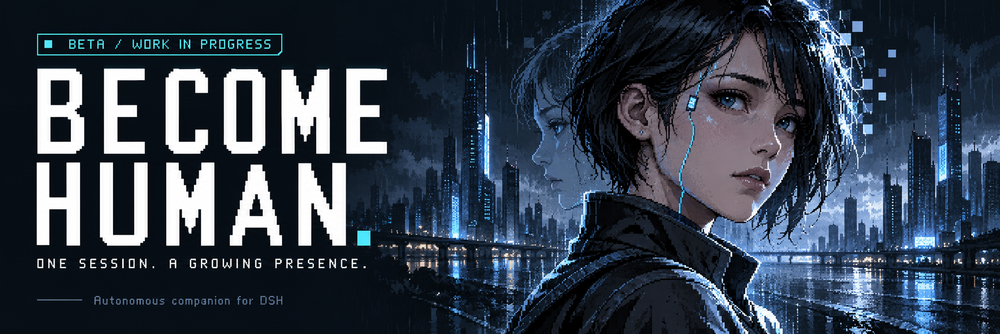
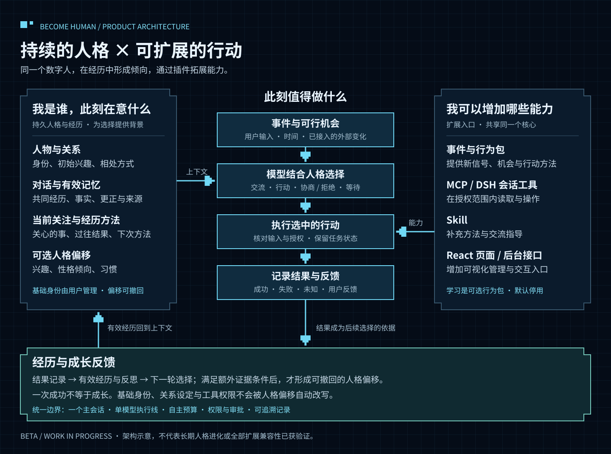
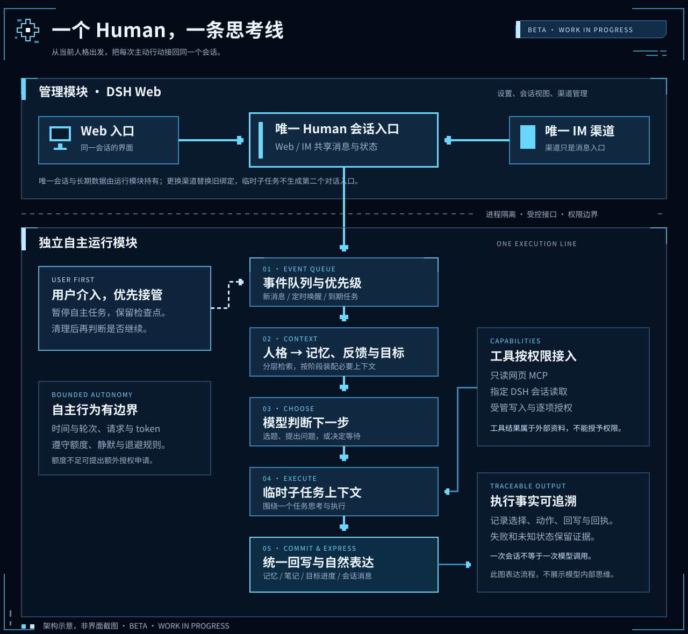

<p align="center">
  
</p>

# Become Human

A digital companion that lives in DSH. Choose its starting personality, what interests it, and how you relate to each other. Past conversations, actions and feedback can then inform what it says or does next.

**Beta `0.7.0-beta.45` · Under development.** [Download the release](https://github.com/liangTc/dsh-become-human/releases/tag/v0.7.0-beta.45) · [npm package](https://www.npmjs.com/package/dsh-become-human-web/v/0.7.0-beta.45) · [Release verification](docs/RELEASE_BETA45.md) · [简体中文](README.md)

[Everyday use](#everyday-use) · [Get started](#get-started) · [Add a capability](#add-a-capability) · [Before you use it](#before-you-use-it)

## Everyday use

| When you… | Human can… |
| --- | --- |
| Send a thought across three short messages | Read adjacent inputs together. Continue the same conversation on the web or on your paired phone. |
| Want a quiet evening | Negotiate a request, change the subject, or wait. Unanswered check-ins back off. Quiet hours can suspend the autonomous loop. |
| Return to yesterday’s work | With work observation enabled, keep excerpts from the DSH sessions you authorize. Inspect the source, annotate the excerpt or ask Human to forget it. |
| Wonder what it did while you were away | Expand one action in the timeline, see outcomes on the task board, or check token usage over the past 24 hours. |
| Want the relationship to evolve | Enable optional personality development. Evidence can support a change in interests, dispositions or habits. Inspect or retract changes. This feature is off by default. |

Yesterday a missing signature held up an export. Today someone posted the acceptance receipt in your work session. Can you just ask Human how it turned out? In a Web test, Human noticed both updates on its own, gave the receipt number from the source conversation, and explained that its part was reading the record. Before offering help, it can also check whether a later update explicitly resolved the original issue. [Read the test record](docs/TESTING_STATUS.md#dsh-work-observation-20261123).

## How it chooses



A wake-up gives Human an opportunity to decide. The model considers the current persona, valid memories, relationships, feedback and goals. It can choose an available action or wait. The runtime checks permissions and the autonomous budget, then records the actual outcome. Your messages take priority over background work. Finishing a task and learning that you liked it require different evidence. [Core design](docs/CORE_DESIGN.md)

## Get started

| Host | Installation |
| --- | --- |
| Windows DSH Desktop `0.2.2-rc.3` or `0.2.2-rc.5` | Download the [combined package](https://github.com/liangTc/dsh-become-human/releases/download/v0.7.0-beta.45/dsh-become-human-web-0.7.0-beta.45.tgz). In **Plugins → Add plugin**, enter its absolute path, enable it and restart when prompted. |
| Windows DSH Web `0.2.0-rc.2` with Node.js 24+ | Configure a model in DSH. For a fresh installation run the commands below. For an upgrade, back up and stop the relevant service first. [Upgrade guide](docs/INSTALLATION.md) |

```powershell
npx @deepseek-ai/dsh@0.2.0-rc.2 plugin --profile web add dsh-become-human-web@0.7.0-beta.45 --registry=https://registry.npmjs.org/
npx @deepseek-ai/dsh@0.2.0-rc.2 web --no-open
```

Open **Human** in the sidebar, choose an existing model, configure personality and budget, then create and start the companion. Send a first message before enabling autonomous activity, setting quiet hours or pairing a phone. Autonomy starts off. The setup wizard prepares a private profile for the bundled worker. Supported model routes reuse host credential references, including compatible third-party routes and the native DeepSeek API key adapter. [Installation and source builds](docs/INSTALLATION.md) · [Usage](docs/USAGE.md) · [Configuration](docs/CONFIGURATION.md)

## Add a capability

Extensions give the same companion more things to do. A change in an external source can become an opportunity. Human may investigate, defer or wait. The outcome can inform its next decision. Plugins can register their own settings and content in the plugin center.

| What you want to add | Where to start |
| --- | --- |
| Events, schedules, actions and feedback | Register them with `humanPlugins`. A timer submits an event. Any later contact goes through Human’s contact policy. [Lifecycle](docs/PLUGIN_LIFECYCLE.md) · [Behavior examples](docs/BEHAVIOR_API.md) |
| An external tool or work session | Connect an MCP tool or grant access to selected DSH sessions. Work observation uses read access. External session writes need separate authorization and per-operation approval. [Usage](docs/USAGE.md) |
| A way of speaking, a working method or a custom page | Skills provide guidance. Tool access is granted separately. Plugins can register React pages and backend methods. [Configuration](docs/CONFIGURATION.md) · [Page API](docs/EXTENSION_PAGES.md) |

Learning is an optional behavior pack. Install and enable it to use its settings and notebooks. Conversation and other enabled activities remain available with learning off. [Plugin developer handbook](https://liangtc.github.io/dsh-become-human/)

## Before you use it

- **Conversation and phone.** Each Human has one durable main session and one active IM binding. Switching channels replaces the old binding. WeChat has real-device verification records. Coverage varies across other adapters.
- **Cost and privacy.** Owner chats and autonomous calls are metered separately. Both can incur provider fees. Autonomous admission uses a local estimate. Data is primarily local, and configured providers receive what their calls require. Install executable extensions from trusted authors.
- **Testing scope.** Image input needs a vision model. Voice and video input are pending. Long-term relationship quality, multi-day stability and additional host combinations remain under test. [Testing status](docs/TESTING_STATUS.md) · [Issues](https://github.com/liangTc/dsh-become-human/issues)

<details>
<summary>Deployment diagram and project resources</summary>



[Architecture](docs/ARCHITECTURE.md) · [Changelog](CHANGELOG.md) · [Community listing](docs/PLUGIN_SUBMISSION.md) · [Contributing](CONTRIBUTING.md) · [Security](SECURITY.md)

</details>

## Credits and license

Become Human runs on [DeepSeek Harness](https://github.com/deepseek-ai/deepseek-harness). IM adapters draw on [dsh-im](https://github.com/xmanrui/dsh-im), and the expression guidance draws on [Humanizer](https://github.com/blader/humanizer). Original code and documentation use the [Apache License 2.0](LICENSE). See [NOTICE](NOTICE) and [third-party notices](THIRD_PARTY_NOTICES.md) for component licenses, artwork and distribution exclusions.
