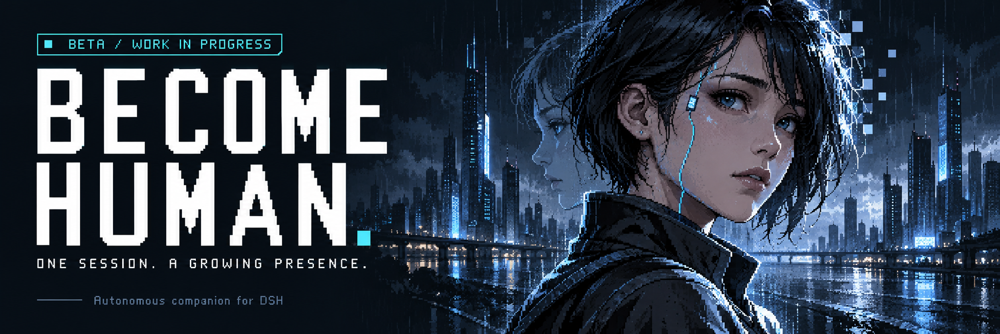
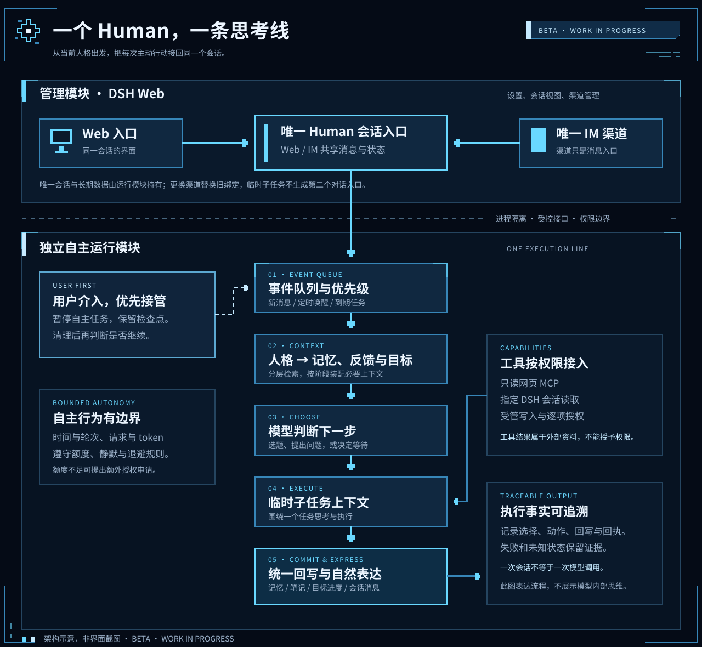

<p align="center">
  
</p>

# Become Human

> **本次测试发行：0.7.0-beta.39。** [下载组合安装包](https://github.com/liangTc/dsh-become-human/releases/tag/v0.7.0-beta.39)，安装和验证边界以[本版发行说明](https://github.com/liangTc/dsh-become-human/blob/main/docs/RELEASE_BETA39.md)为准。下文 beta.5 为历史发行说明；npm 发布状态单独确认。

**让一个有持续记忆、独特性格和自主行动能力的数字人，生活在你的 DSH 中。**

[English](README.en.md) · [安装指南](docs/INSTALLATION.md) · [使用指南](docs/USAGE.md) · [配置说明](docs/CONFIGURATION.md) · [测试状态](docs/TESTING_STATUS.md)

> [!WARNING]
> **测试中，尚未开发完成。** 本目录对应 `0.7.0-beta.39` 测试版，不能将历次短测视为完整稳定性验收。当前支持范围为 **Windows + Node.js 24+ + DSH `0.2.0-rc.2` 的 Web profile**。完整新装与长期稳定性仍待验收。

## 它是什么

Become Human 是一个 DSH Web 插件，配有独立运行模块。它围绕一个持久主会话工作，根据**当前人物配置、有效记忆、反馈与目标**，决定何时交流、处理事情或等待。

核心循环是：**接收事件 → 选择行动 → 执行 → 记录结果与反馈 → 更新记忆和成长依据**。人物不必绑定固定职业，也不需要一直填充待办。学习只是默认停用的可选行为包，和其他扩展一样按需加入。

我们希望它能更自然地相处，并从经历中逐步形成特点。这里的“自主”指模型在事件循环中选择行动；人格变化需要证据、可查看并可撤回，不代表已经证明真人意识或长期人格进化。

## 当前能力

以下描述对应当前开发源码，具体通过范围见[测试记录](docs/TESTING_STATUS.md)，不能直接套用于旧版安装包。

| 你可以做什么 | 对应能力 |
| --- | --- |
| 定义你想相处的人物 | 人物与关系预设、自定义配置、兴趣与长期方向；可选人格偏移及依据查看 |
| 持续聊天，不反复从头介绍 | 完整问答轮次、滚动摘要、长期记忆；连续输入合并、短回复和分条；支持视觉模型的图片输入 |
| 让它适时主动，而不是一直打扰 | 事件与定时唤醒、主动闲聊、未回复退避、注意力管理；主人输入优先 |
| 让它处理一件事并追踪结果 | 目标与子任务、关注事项、定时任务、暂停恢复、结果反思、审批后的受管文件产物 |
| 查看它做了什么、记住了什么 | 任务看板、活动时间线、事件日志；记忆查看、修订、遗忘与维护记录 |
| 看清并控制消耗 | 自主 token、请求与轮次等预算；近 24 小时及额度周期统计，按工作和模型分类 |
| 从手机接着聊 | Web 与一个有效 IM 渠道共享主会话；本人配对、统一消息与投递状态 |
| 加入工具和新行为 | 文本 Skill、MCP、经授权的 DSH 会话读写与工作观察、可安装行为包 |
| 为扩展增加管理界面 | Human 内自定义 React 页面、声明式页面和扩展后台接口；安装、配置、启停、升级与移除 |

## 怎么运行



- **一个 Human，一个持久主会话。** 临时任务上下文不形成第二个人格；外部 DSH 会话只是授权后的资料或执行目标。
- **一个 Human，同时绑定一个有效 IM 渠道。** 更换渠道会替换旧绑定，Web 始终共享同一会话。
- **Web 负责管理，独立模块负责运行。** 组合包包含两者，向导准备私有 profile 和内部端口；不要把内部运行包单独安装到日常 profile。
- **代码管理执行边界，模型选择具体行动。** 人格与关系影响交流，不扩大工具权限。DSH 会话写入默认关闭，需要授权目标并逐笔审批。

## 安装与开始使用

### 1. 选择版本

| 来源 | 当前状态 |
| --- | --- |
| 本目录开发源码 `0.7.0-beta.39` | 包含本页所述新能力；可从上方测试发行下载组合包，也可自行构建 |
| [历史测试发行 `0.7.0-beta.5`](https://github.com/liangTc/dsh-become-human/releases/tag/v0.7.0-beta.5) | 提供 `.tgz` 与 SHA-256，但存在首次创建 Human 可能失败的已知初始化问题；修复已进入后续源码 |
| npm | 尚未发布；不要把包名当作已可用的 npm 安装来源 |

**首次体验请优先使用 beta.39 组合包，或由对应源码构建。** 本地源码、GitHub 分支与 Release 可能不同步，先核对下载源码的 `package.json`；源码 ZIP 本身不是插件安装包。

### 2. 构建并安装

先准备上述支持版本的 DSH，并在宿主中配置可用模型。进入所下载源码的根目录，执行：

```powershell
npm install --prefix plugins/become-human-web
npm run build
npm run release:package
```

打包输出位于 `dist/packages/`。停止要更新的 DSH 服务后，在同一源码目录执行以下命令，按源码版本选择安装包：

```powershell
$humanVersion = (Get-Content ./plugins/become-human-web/package.json -Raw | ConvertFrom-Json).version
$humanPackage = "./dist/packages/dsh-become-human-web-$humanVersion.tgz"
npx @deepseek-ai/dsh@0.2.0-rc.2 plugin --profile web add $humanPackage
npx @deepseek-ai/dsh@0.2.0-rc.2 web --no-open
```

预构建包安装、校验、升级与常见问题见[安装指南](docs/INSTALLATION.md)。已有用户先备份，升级后核对原会话、数据和绑定，不要通过删除数据或重建 Human 完成升级。

### 3. 完成向导

打开 DSH 启动时给出的访问链接，进入 **Human → 选择已有模型 → 人物与额度 → 创建并启动**。

模型可来自兼容的第三方路由或 DSH 原生 DeepSeek API Key 通道，凭据通过宿主引用解析。宿主未配置 API 时，先在 DSH 完成配置，再回 Human 重新检查；账号登录认证不在支持范围。

首次自主活动默认关闭，建议先完成一次正常对话，再按需开启自主、接入手机和添加扩展。**开启自主不会自动开启学习**。后台随宿主服务运行；冷启动后的恢复行为与故障状态请按页面提示处理。详细设置见[配置说明](docs/CONFIGURATION.md)。

## 按需扩展

| 扩展方式 | 用途与边界 | 文档 |
| --- | --- | --- |
| Skill | 补充表达或工作方法；文本说明本身不授予工具执行权限 | [配置](docs/CONFIGURATION.md) |
| 行为包 | 为事件循环增加来源、行动和结果反馈；学习与经历回顾提供参考实现 | [行为扩展 API](docs/BEHAVIOR_API.md) |
| MCP / DSH 会话 | 连接外部工具，授权读取或使用指定范围的宿主会话 | [使用指南](docs/USAGE.md) |
| 扩展页面 | 在 Human 内增加 React 或声明式页面，调用扩展声明的后台接口 | [页面与后台接口](docs/EXTENSION_PAGES.md) |

可选行为包可通过 `npm run release:behaviors` 单独打包，再在扩展管理中安装实际生成的 `.tgz`。学习包安装后仍默认停用，已有笔记不会因停用而删除。

可执行扩展属于**可信代码**；页面隔离不等于恶意代码沙箱。任意第三方扩展、其他 DSH 版本和通用自主工具规划尚未全面验证。Human 不提供浏览器标签页或桌面窗口控制。

## 手机与使用边界

开源发行保留 12 种聊天渠道实现：微信、飞书、钉钉、企业微信、企业微信应用、QQ、Slack、Telegram、Discord、iMessage、邮箱、Matrix；另有 AI Office 连接器。**提供适配代码不代表全部渠道已经实测或即装即用**。微信已有真实流程记录；iMessage 需要 macOS，与当前完整运行时的 Windows 支持范围不同。

- **消耗：** 主人聊天独立计量，仍产生模型费用；自主预算使用保守准入估算，不是供应商账单的硬上限。
- **交流与成长：** 自然表达、长期召回和人格变化仍在验证；图片识别也可能误读。语音与视频尚未接入。
- **外部操作：** 核对写入预览与授权。结果为 `unknown` 时先检查实际状态，不自动重发；渠道在线和发送回执不等于手机实收。
- **可用性：** 网络、休眠、模型限流和 IM 平台窗口会影响运行。当前没有完成最新版连续 24 小时及多日稳定性验收。
- **数据：** 数据主要保存在本地，模型、搜索和 IM 会接收调用所需内容。不要公开凭据、认证链接、数据库和私人聊天；Windows DPAPI 加密备份不等于跨机器迁移方案。

## 文档与反馈

| 文档 | 内容 |
| --- | --- |
| [安装](docs/INSTALLATION.md) / [使用](docs/USAGE.md) / [配置](docs/CONFIGURATION.md) | 从首次启动到日常使用 |
| [核心设计](docs/CORE_DESIGN.md) / [架构](docs/ARCHITECTURE.md) | 事件循环、主会话、运行模块与扩展边界 |
| [测试状态](docs/TESTING_STATUS.md) | 已通过、失败、未验证及后置项目 |
| [变更记录](CHANGELOG.md) | 各版本改动与验证范围 |
| [发行与社区登记](docs/PLUGIN_SUBMISSION.md) | Release、社区登记与插件市场的区别 |
| [贡献指南](CONTRIBUTING.md) / [安全说明](SECURITY.md) | 开发约定、问题与漏洞反馈 |

欢迎通过 [GitHub Issues](https://github.com/liangTc/dsh-become-human/issues) 反馈版本、复现步骤和脱敏后的错误。社区登记不代表 DSH 官方背书，当前验收范围以仓库记录为准。

## 致谢与许可

- [DeepSeek Harness](https://github.com/deepseek-ai/deepseek-harness)：插件宿主、模型、会话服务及纯日历规则。
- [dsh-im](https://github.com/xmanrui/dsh-im)：IM 渠道与配置实现的主要上游，按 Human 单会话、单渠道机制适配。
- [Humanizer](https://github.com/blader/humanizer)：表达指导及中文对话适配的参考。

原创代码与文档采用 **[Apache License 2.0](LICENSE)**。第三方代码、Skill、图标和依赖保留各自许可，见 [NOTICE](NOTICE) 与 [THIRD_PARTY_NOTICES.md](THIRD_PARTY_NOTICES.md)。开源包排除 WhatsApp 及相关 GPL 依赖链，也不包含未获开源分发许可的 QQ 扫码连接器；QQ 使用手动凭据配置。

本项目独立维护，上游名称和商标仅用于说明兼容性与来源。
