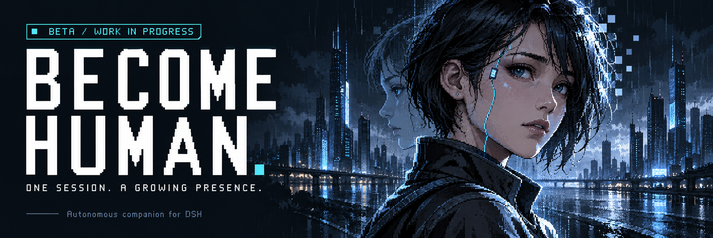
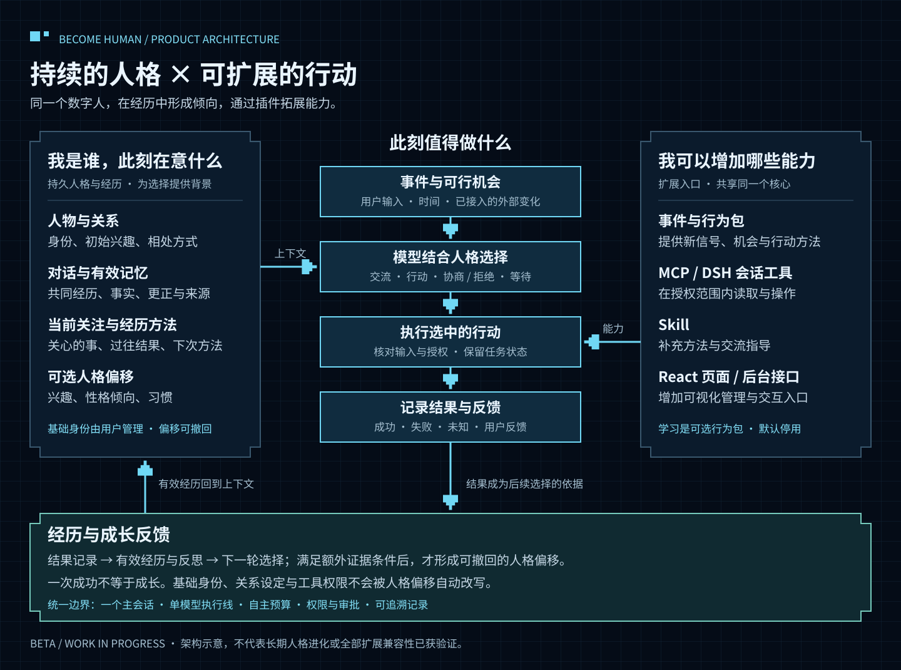
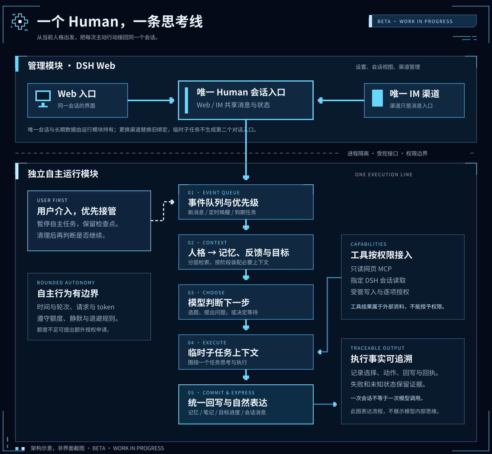

<p align="center">
  
</p>

# Become Human

住在 DSH 里的数字人。你可以决定你们是什么关系、它对什么好奇。聊过的事、做过的事，以及你后来的反馈，都会成为它下一次开口或行动时可以参考的经历。

**测试版 `0.7.0-beta.45`，仍在开发中。** [下载测试版](https://github.com/liangTc/dsh-become-human/releases/tag/v0.7.0-beta.45) · [npm 安装包](https://www.npmjs.com/package/dsh-become-human-web/v/0.7.0-beta.45) · [本版验证范围](docs/RELEASE_BETA45.md) · [English](README.en.md)

[和它相处](#和它相处) · [开始使用](#开始使用) · [给它增加能力](#给它增加能力) · [使用边界](#使用边界)

## 和它相处

| 你遇到的事 | Human 可以怎么回应 |
| --- | --- |
| 一件事分了三条消息才讲完 | 把相邻输入合起来理解。你从网页换到已配对的手机，继续的是同一段对话。 |
| 今天想早点休息 | 可以和你商量、调整话题。你没回时，主动联系会退避。设置安静时段后，自主循环也可以在这段时间休息。 |
| 昨天的项目今天有了进展 | 开启工作观察并授权指定 DSH 会话后，它可以摘下有出处的变化。你可以查看、批注或让它忘记一条工作记忆。 |
| 想知道它刚才做了什么 | 时间线可以展开单次行动。任务看板显示事项和结果，用量页可以查最近 24 小时的消耗。 |
| 想让相处方式慢慢变化 | 人物设定给出起点。可选的「人格偏移」会根据有效经历形成兴趣、倾向或习惯，你可以查看依据并撤回变化。该选项默认关闭。 |

昨天你在工作会话里说“导出卡在复核签名”，今天又补了一句“验收通过了”。你只问 Human “后来怎样了？”，它能接上吗？在 Web 实测里，它自行发现了更新，答出了只在原会话出现过的回执编号，也说清了自己只读过记录。给同一件事提议协助前，它还可以核对后来有没有明确的解决记录。[测试经过](docs/TESTING_STATUS.md#dsh-work-observation-20261123)

## 它怎样决定下一步



一次唤醒给 Human 一个选择的机会。模型结合**当前人物、有效记忆、关系、反馈和目标**，决定采取一个已启用的行动，或等一等。决定行动后，后台核对权限与自主预算，记录实际结果。你发来消息时，前台对话优先。完成某个任务、你喜欢它做这件事、它逐渐形成某种兴趣，各自需要相应的依据。[核心设计](docs/CORE_DESIGN.md)

## 开始使用

| 宿主 | 安装方式 |
| --- | --- |
| Windows DSH Desktop `0.2.2-rc.3` 或 `0.2.2-rc.5` | 下载[组合包](https://github.com/liangTc/dsh-become-human/releases/download/v0.7.0-beta.45/dsh-become-human-web-0.7.0-beta.45.tgz)。在左侧「插件 → 添加插件」填入文件绝对路径，启用后按提示重启。 |
| Windows DSH Web `0.2.0-rc.2`，Node.js 24+ | 在 DSH 配好模型。首次安装使用下方命令；已有安装请先按[升级说明](docs/INSTALLATION.md)备份并停止对应服务。 |

```powershell
npx @deepseek-ai/dsh@0.2.0-rc.2 plugin --profile web add dsh-become-human-web@0.7.0-beta.45 --registry=https://registry.npmjs.org/
npx @deepseek-ai/dsh@0.2.0-rc.2 web --no-open
```

打开侧栏 **Human → 选择已有模型 → 人物与额度 → 创建并启动**。先发第一条消息，再决定是否开启自主活动、设置安静时段，或配对手机。首次自主活动默认关闭。组合包自带独立运行模块，向导会准备它的私有 profile。模型复用宿主的凭据引用，支持兼容第三方路由和原生 DeepSeek API Key。[安装与源码构建](docs/INSTALLATION.md) · [日常使用](docs/USAGE.md) · [配置](docs/CONFIGURATION.md)

## 给它增加能力

插件为同一个人物提供新的事情可做。例如，一个扩展可以在外部来源有变化时提交机会，Human 可以选择了解、稍后处理或等待。执行回执可以引出下一次选择。插件在「插件」页注册自己的设置和内容，主人仍可以单独停用它。

| 你想加什么 | 从哪里开始 |
| --- | --- |
| 新事件、定时活动、行动和结果反馈 | 使用 `humanPlugins` 注册。定时器提交事件，联系主人仍经过统一策略。[生命周期合同](docs/PLUGIN_LIFECYCLE.md) · [行为示例](docs/BEHAVIOR_API.md) |
| 外部工具，或指定 DSH 工作会话 | 接入 MCP，或单独配置 DSH 会话读写授权。工作观察只需读授权；向外部会话写入还要逐笔审批。[使用指南](docs/USAGE.md) |
| 表达方式、办事方法或专属页面 | Skill 提供方法，工具权限另行授权。扩展也可注册 React 页面和后台方法。[配置](docs/CONFIGURATION.md) · [页面接口](docs/EXTENSION_PAGES.md) |

学习是一个可选行为包。需要时单独安装并启用，设置与笔记随包出现。只想聊天、相处或协作，也可以一直关闭学习。[插件开发手册](https://liangtc.github.io/dsh-become-human/)

## 使用边界

- **会话和渠道。** 一个 Human 有一个持久主会话，同时绑定一个有效 IM。更换渠道会替换旧绑定。微信已有手机实收记录，其他适配器的验证程度不同。
- **费用和数据。** 主人聊天和自主活动分别计量，都会产生模型费用。自主预算是本地估算。资料主要保存在本机，模型、搜索和 IM 服务会接收相应调用所需的内容。可执行扩展需要信任其作者。
- **当前验证范围。** 图片输入需要视觉模型，语音与视频尚待接入。长期相处质量、跨日稳定性及其他宿主组合仍在测试。遇到问题可以在日志页导出脱敏记录。[测试状态](docs/TESTING_STATUS.md) · [反馈问题](https://github.com/liangTc/dsh-become-human/issues)

<details>
<summary>查看部署结构与维护文档</summary>



[架构说明](docs/ARCHITECTURE.md) · [变更记录](CHANGELOG.md) · [社区登记](docs/PLUGIN_SUBMISSION.md) · [贡献指南](CONTRIBUTING.md) · [安全反馈](SECURITY.md)

</details>

## 致谢与许可

项目运行在 [DeepSeek Harness](https://github.com/deepseek-ai/deepseek-harness) 上。IM 适配参考 [dsh-im](https://github.com/xmanrui/dsh-im)，表达指导参考 [Humanizer](https://github.com/blader/humanizer)。原创代码与文档采用 [Apache License 2.0](LICENSE)。第三方组件、素材和发行排除项见 [NOTICE](NOTICE) 和[第三方许可说明](THIRD_PARTY_NOTICES.md)。
